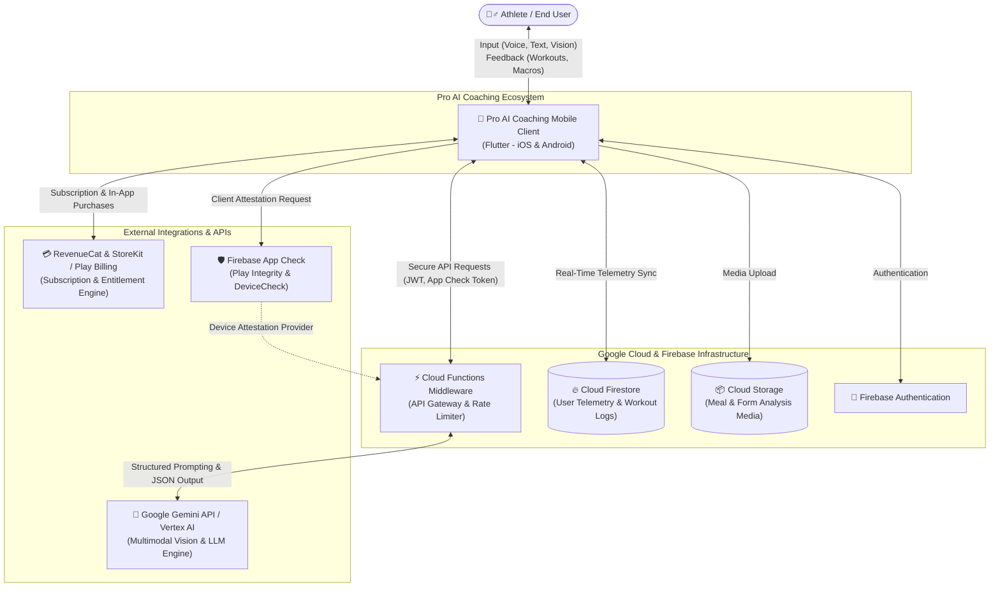
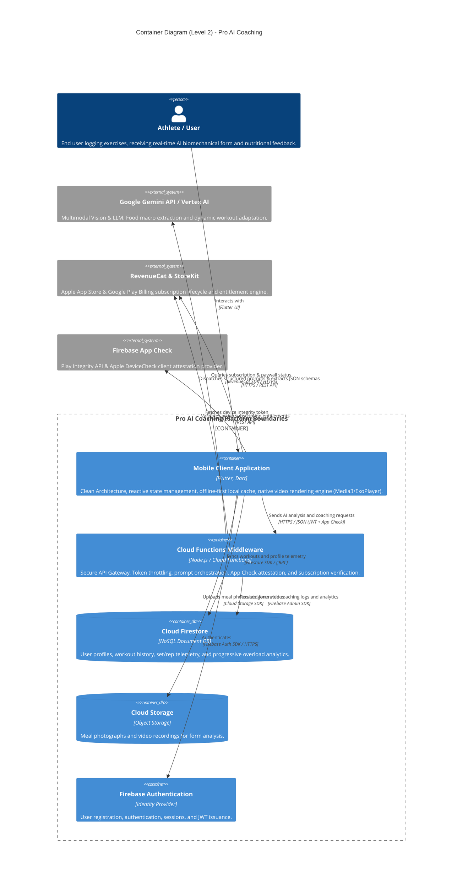
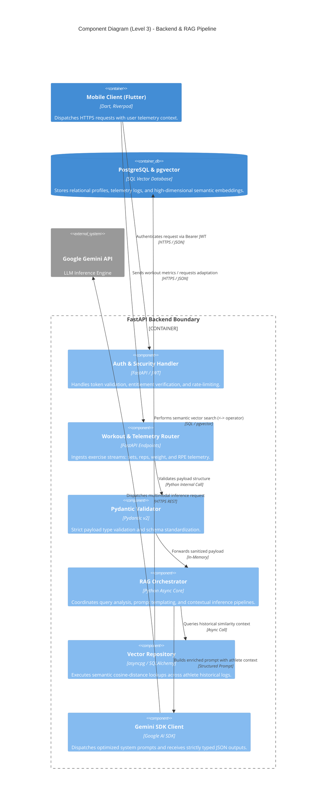

# 🏛️ Pro AI Coaching – System Architecture

Pro AI Coaching features an end-to-end hybrid mobile architecture engineered to process athletes' historical workout logs, fatigue/RPE metrics, multimodal meal inputs, and progressive overload telemetry to deliver real-time biomechanical and nutritional adaptations.

This document outlines the client architecture, cloud services, artificial intelligence pipelines, and security protocols structured according to the C4 model standards.

---

## 📌 Level 1: System Context Diagram

Visualizes user interactions, platform boundaries, and third-party enterprise integrations.

---

## 📌 Level 2: Container Diagram

Models the high-level technical runtime, responsibilities of independent containers (client, serverless middleware, databases, storage), and inter-service communication protocols.

### Container & Protocol Specifications

| Container / Component | Technology Stack | Network Protocol | Primary Responsibility |
| :--- | :--- | :--- | :--- |
| **Mobile Client** | Flutter, Dart | Native SDK & HTTPS | Cross-platform UI, reactive state handling, and local media processing. |
| **Backend Middleware** | Firebase Cloud Functions | HTTPS / REST (JSON) | API key isolation, rate-limiting, and prompt orchestration. |
| **Database** | Cloud Firestore | gRPC / Firestore SDK | Offline-first sync for workout telemetry, user profiles, and hypertrophy trends. |
| **Media Storage** | Cloud Storage | HTTPS / Storage SDK | Secure object storage for nutritional images and form analysis videos. |
| **AI Inference Engine**| Gemini API / Vertex AI | HTTPS / REST | Multimodal meal analysis, real-time exercise substitution, and coaching inferences. |
| **Client Attestation** | Firebase App Check | Play Integrity / DeviceCheck | Prevents unauthorized bots, emulators, and API abuse via cryptographic attestation. |

---

## 📌 Level 3: Component Diagram (Backend & RAG Pipeline)

Illustrates the internal service architecture of the backend tier, highlighting request validation, semantic search pipelines with pgvector, and contextual RAG (Retrieval-Augmented Generation) flows.

### Component Architectural Highlights

1. **Deterministic RAG Orchestration:** Requests are not passed directly to the raw model. The `Vector Repository` retrieves the athlete's last 3–4 weeks of volume loading, active joint fatigue markers, and past failure points, injecting them as grounded context into the prompt schema to prevent hallucinations.
2. **Strict Type Safety (Pydantic v2):** Missing workout variables, corrupt RPE values, or malformed telemetry payloads are intercepted and rejected at the gateway boundary before hitting backend compute.
3. **Non-Blocking Asynchronous I/O:** Relational transactions and vector similarity lookups run concurrently via connection-pooled `asyncpg` drivers to minimize inference latency during live gym sessions.
