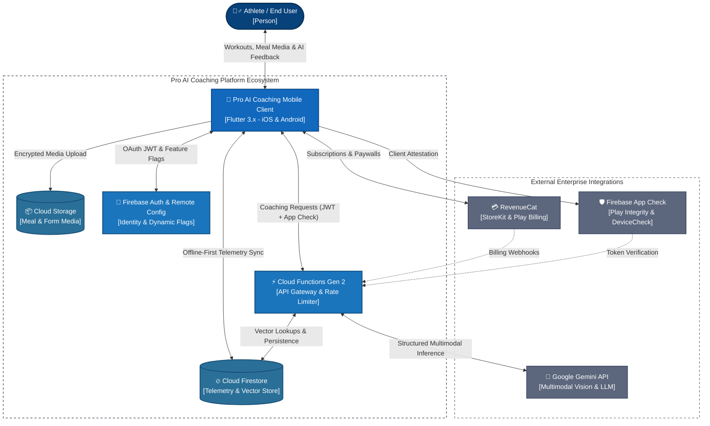
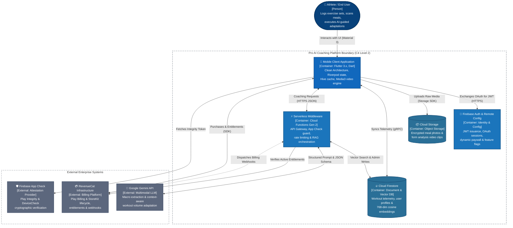
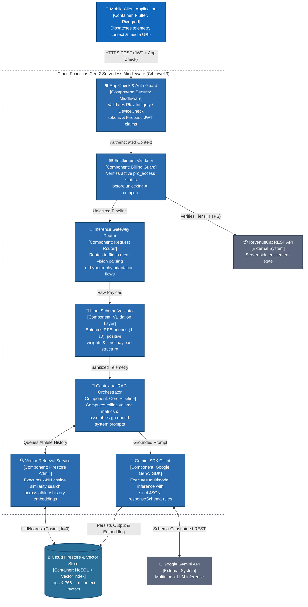
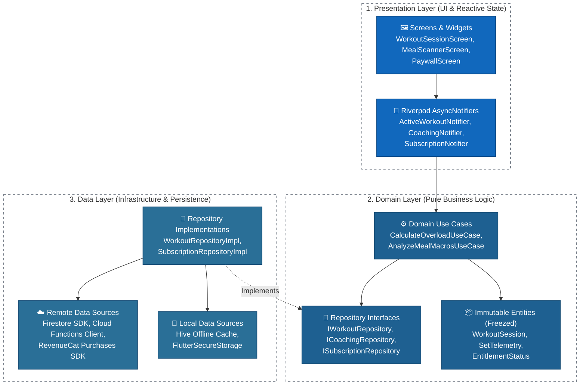
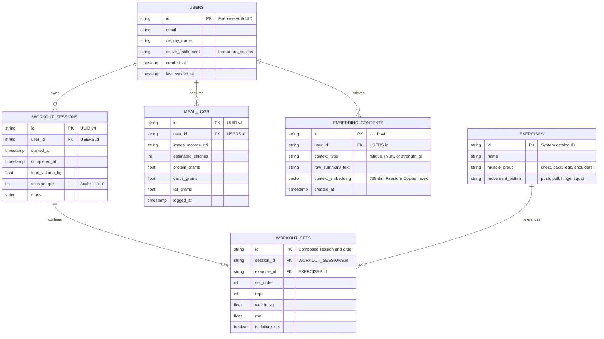
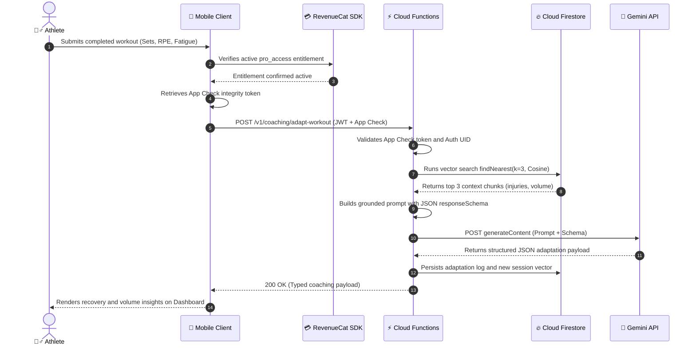
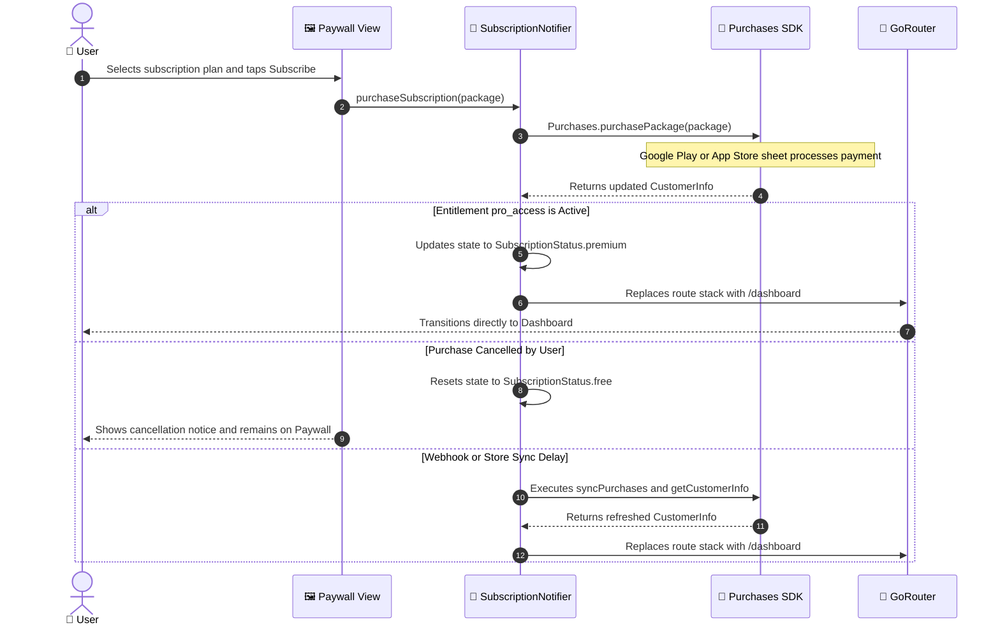

# 🏛️ Pro AI Coaching – Enterprise System Architecture & Engineering Documentation

[](https://c4model.com/)
[](https://flutter.dev)
[](https://firebase.google.com/docs/functions)
[](https://firebase.google.com/docs/firestore)
[](https://ai.google.dev/)
[](https://www.revenuecat.com/)
[](https://firebase.google.com/docs/app-check)
[](https://codemagic.io/)

---

## 📌 Executive Summary

**Pro AI Coaching** is an enterprise-grade mobile health and fitness platform engineered with Flutter. The system ingests and processes high-frequency workout telemetry (set/rep volume, Rate of Perceived Exertion [RPE], fatigue indexes) alongside multimodal meal imagery to deliver real-time biomechanical feedback and dynamic nutritional adaptations.

The architecture eliminates client-side API key exposure through a secure serverless gateway, executes high-dimensional semantic lookups via Cloud Firestore Vector Search, and isolates cross-platform billing operations using RevenueCat. This document details the end-to-end design across all four levels of the C4 model, alongside data persistence schemas, RAG orchestration flows, and security protocols.

---

## 🏛️ Level 1: System Context Diagram

Visualizes core user interactions, platform boundaries, managed cloud services, and third-party enterprise integrations.



---

## 📦 Level 2: Container Diagram

Decomposes the platform boundary into independently deployable containers, detailing runtime environments, core responsibilities, and inter-service network protocols.



### Container Specifications & Network Matrix

| Container / Component | Technology Stack | Network Protocol | Primary Responsibility |
| :--- | :--- | :--- | :--- |
| **Mobile Client** | Flutter 3.x, Dart | Native SDK / HTTPS / gRPC | Cross-platform UI rendering, reactive state management, offline caching, native media capture. |
| **Backend Middleware** | Cloud Functions Gen 2 | HTTPS / REST (JSON) | API key isolation, token rate-limiting, device attestation checks, RAG prompt assembly. |
| **Document & Vector DB**| Cloud Firestore | gRPC / Firestore SDK | Offline-first telemetry synchronization, user profiles, native vector indexing (`findNearest`). |
| **Media Storage** | Cloud Storage | HTTPS / Storage SDK | Access-controlled object storage for nutritional imagery and biomechanical video clips. |
| **Identity & Config** | Firebase Auth & Config | HTTPS / Firebase SDK | OAuth credential handling, short-lived JWT issuance, remote feature and paywall flags. |
| **AI Inference Engine** | Google Gemini API | HTTPS / REST | Multimodal computer vision, contextual reasoning, strict JSON schema output generation. |
| **Entitlement Service** | RevenueCat | HTTPS / REST & Webhooks | Cross-platform paywall orchestration, Google Play Billing and Apple StoreKit validation. |

---

## 🧩 Level 3: Component Diagram (Serverless Middleware & RAG Pipeline)

Inspects the internal modular architecture of the Cloud Functions middleware, illustrating how client requests are attested, validated, enriched with semantic history, and routed to Gemini.



### Component Design Highlights

1. **Gatekeeping via Cryptographic Attestation:** The `App Check & Auth Guard` rejects requests lacking valid Play Integrity or DeviceCheck tokens at the edge, neutralizing automated scraping and denial-of-wallet attacks before invoking downstream compute.
2. **Deterministic Schema Enforcement:** Calls dispatched through the `Gemini SDK Client` enforce strict `responseSchema` declarations, ensuring LLM outputs conform to strongly typed JSON contracts with zero client parsing failures.
3. **Single-Hop Semantic Grounding:** Rather than maintaining a separate vector cluster, the `Vector Retrieval Service` leverages Cloud Firestore's native `findNearest` cosine index to retrieve the athlete's top 3 relevant fatigue, injury, or volume logs in a single low-latency roundtrip.

---

## 🧱 Level 4: Code & Clean Architecture (Mobile Client)

The Flutter client enforces strict separation of concerns via Clean Architecture and Feature-First modularization, decoupling presentation state from core domain rules and external SDKs.



### Modular Directory Structure

```text
lib/
├── core/                                # Cross-cutting application infrastructure
│   ├── constants/                       # Route paths, entitlement IDs, design tokens
│   ├── network/                         # Dio HTTP client, App Check & JWT interceptors
│   ├── services/                        # Native bridges, Media3 / ExoPlayer controllers
│   └── errors/                          # Typed Failure classes and exception mappers
├── features/                            # Encapsulated feature-first modules
│   ├── workout_tracking/                # Exercise, set, rep, and RPE logging engine
│   │   ├── data/
│   │   │   ├── datasources/             # Hive local box & Firestore remote service
│   │   │   ├── models/                  # Freezed DTOs and JSON serialization models
│   │   │   └── repositories/            # WorkoutRepositoryImpl
│   │   ├── domain/
│   │   │   ├── entities/                # WorkoutSession, SetMetric, FatigueIndex
│   │   │   ├── repositories/            # IWorkoutRepository (Abstract contract)
│   │   │   └── usecases/                # SyncSessionUseCase, CalculateProgressiveOverload
│   │   └── presentation/
│   │       ├── controllers/             # ActiveWorkoutNotifier (AsyncNotifierProvider)
│   │       └── widgets/                 # SetInputRow, LiveVolumeChart, RestTimer
│   ├── ai_coaching/                     # Multimodal meal scanner & workout adaptation
│   │   ├── data/                        # Cloud Function gateways & Gemini DTO mappers
│   │   ├── domain/                      # BiomechanicalFeedback & NutritionalPlan entities
│   │   └── presentation/                # CameraOverlay, AnalysisBottomSheet
│   └── subscription/                    # Monetization, paywalls, and billing lifecycle
│       ├── data/                        # RevenueCat Purchases SDK service wrapper
│       ├── domain/                      # EntitlementStatus, SubscriptionPackage entities
│       └── presentation/                # PaywallScreen, SubscriptionStatusListener
└── main.dart                            # ProviderScope bootstrap & Firebase initialization
```

---

## 🗄️ Data Model: Cloud Firestore Schema & Vector Search (ERD)

Balances real-time offline-first document synchronization with high-throughput workout set logging and 768-dimensional semantic embeddings.



---

## ⚡ Multimodal RAG & Inference Sequence

Illustrates the end-to-end execution flow transforming raw session telemetry into grounded coaching adaptations without exposing backend credentials on the client.



---

## 💳 Subscription & Navigation Lifecycle (RevenueCat)

Prevents post-purchase navigation lockups by coordinating native billing sheets, entitlement verification, and router transitions through a single reactive notifier.



### Post-Purchase Deterministic Routing Snippet

```dart
Future<void> purchaseSubscription(Package package) async {
  state = const AsyncValue.loading();
  try {
    final customerInfo = await Purchases.purchasePackage(package);
    final isEntitled =
        customerInfo.entitlements.all['pro_access']?.isActive ?? false;

    if (isEntitled) {
      state = const AsyncValue.data(SubscriptionStatus.premium);
      ref.read(appRouterProvider).go('/dashboard');
    } else {
      final syncedInfo = await Purchases.getCustomerInfo();
      final isSyncedEntitled =
          syncedInfo.entitlements.all['pro_access']?.isActive ?? false;

      if (isSyncedEntitled) {
        state = const AsyncValue.data(SubscriptionStatus.premium);
        ref.read(appRouterProvider).go('/dashboard');
      } else {
        state = const AsyncValue.data(SubscriptionStatus.free);
      }
    }
  } on PlatformException catch (e) {
    final errorCode = PurchasesErrorHelper.getErrorCode(e);
    if (errorCode == PurchasesErrorCode.purchaseCancelledError) {
      state = const AsyncValue.data(SubscriptionStatus.free);
    } else {
      state = AsyncValue.error(e, StackTrace.current);
    }
  }
}
```

---

## 🛡️ Enterprise Security, Reliability & CI/CD Standards

* **Zero-Trust Client Boundary:** All Gemini API credentials, prompt templates, and system instructions remain isolated inside Cloud Functions Gen 2; zero secret keys are bundled into compiled mobile binaries.
* **Cryptographic Client Attestation:** Backend endpoints enforce Firebase App Check verification via Google Play Integrity (Android) and Apple DeviceCheck / App Attest (iOS) prior to processing requests.
* **Schema-Enforced AI Outputs:** Serverless functions validate incoming telemetry ranges and constrain Gemini responses via `responseSchema`, guaranteeing deterministic JSON deserialization on the mobile client.
* **Offline-First Resilience:** Workout sets and RPE logs write immediately to local Hive storage and synchronize asynchronously to Cloud Firestore over persistent gRPC channels, preventing data loss in low-connectivity gym environments.
* **Automated CI/CD Pipelines:** Codemagic workflows run static analysis (`flutter analyze`), unit tests, environment secret injection, and automated code signing for Google Play Store (AAB) and Apple App Store (IPA) releases.
