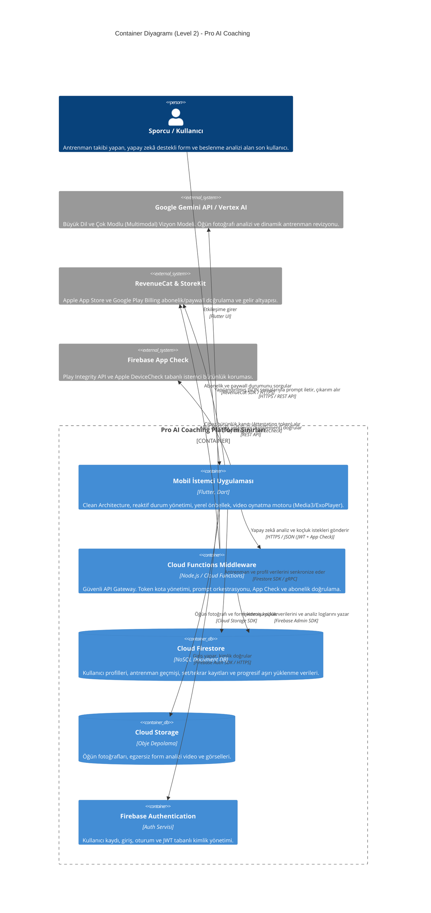
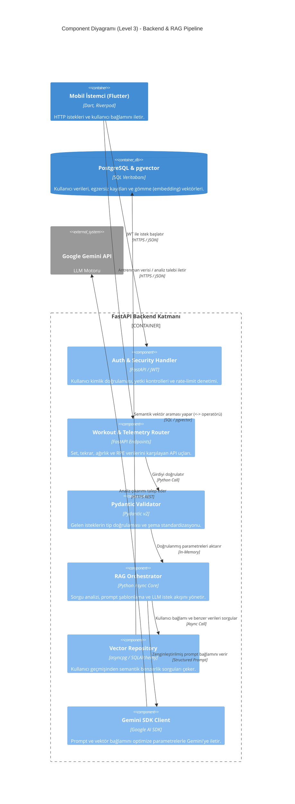

# 🏛️ Pro AI Coaching – Sistem Mimarisi (System Architecture)

Pro AI Coaching; sporcuların antrenman geçmişini, yorgunluk/RPE metriklerini, görsel öğün analizlerini ve hipertrofi hedeflerini işleyerek salondayken anlık biyomekanik ve beslenme uyarlamaları sunan uçtan uca hibrit bir mobil mimariye sahiptir.

Bu doküman, sistemin istemci mimarisini, bulut servislerini, yapay zekâ katmanını ve güvenlik protokollerini C4 model prensiplerine uygun olarak görselleştirir.

---

## 📌 1. Seviye: Sistem Bağlam Diyagramı (System Context - Level 1)

Kullanıcının sistemle olan etkileşimini, platform sınırlarını ve dış servis entegrasyonlarını özetler.

---

## 📌 2. Seviye: Kapsayıcı Diyagramı (Container Diagram - Level 2)

Bu diyagram; sistemin yüksek seviyeli teknik mimarisini, sorumluluk alanlarına göre ayrılmış servisleri (istemci, sunucusuz backend, veritabanı, depolama) ve aralarındaki ağ/protokol bağlantılarını modeller.

### Kapsayıcı ve Protokol Özeti

| Kapsayıcı / Bileşen | Teknoloji | İletişim Protokolü | Görev ve Sorumluluk |
| :--- | :--- | :--- | :--- |
| **Mobil İstemci** | Flutter, Dart | Yerel SDK & HTTPS | Kullanıcı arayüzü, reaktif durum yönetimi ve yerel medya akışı. |
| **Backend Middleware** | Firebase Cloud Functions | HTTPS / REST (JSON) | API anahtarı gizleme, hız sınırlama (rate-limiting) ve prompt orkestrasyonu. |
| **Veritabanı** | Cloud Firestore | gRPC / Firestore SDK | Çevrimdışı destekli antrenman logları, kullanıcı hedefleri ve metrik takibi. |
| **Medya Depolama** | Cloud Storage | HTTPS / Storage SDK | Yemek fotoğrafları ve form analizi videolarının güvenli saklanması. |
| **Yapay Zekâ Motoru**| Gemini API / Vertex AI | HTTPS / REST | Görselden makro çıkarma, anlık egzersiz alternatifi ve koçluk akışı. |
| **Uç Nokta Doğrulama**| Firebase App Check | Play Integrity / DeviceCheck | Sahte istemcileri, emülatörleri ve yetkisiz API sızıntılarını engelleme. |

---

## 📌 3. Seviye: Bileşen Diyagramı (Component Diagram - Level 3: Backend & RAG Pipeline)

Bu diyagram; Python / FastAPI backend kapsayıcısının iç mimarisini, veri doğrulama mantığını, pgvector semantik arama hattını ve harici LLM servisleri ile kurulan RAG (Retrieval-Augmented Generation) orkestrasyonunu modeller.

### Bileşen Düzeyi Mimari Detaylar

1. **RAG Orkestrasyonu:** Kullanıcı doğrudan yapay zekâya bırakılmaz; Vector Repository üzerinden kullanıcının son antrenman geçmişi, sakatlık geçmişi ve hacim yükü çekilerek prompt şablonuna bağlam (context) olarak eklenir. Halüsinasyon riski sıfıra indirilir.
2. **Tip Güvenliği (Pydantic v2):** Mobil taraftan gelen eksik veya hatalı set/tekrar verileri sunucu çekirdeğine ulaşmadan sınırda filtrelenir.
3. **Asenkron Veritabanı Erişimi:** Vektör sorguları ve ilişkisel veri okuma işlemleri asyncpg havuzu üzerinden non-blocking olarak yürütülür.
