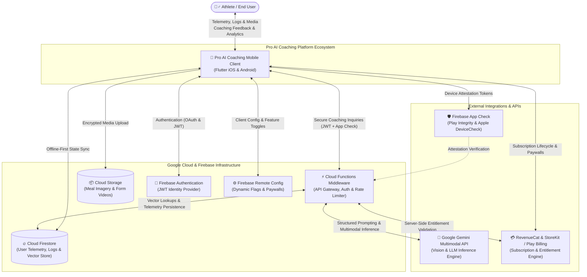
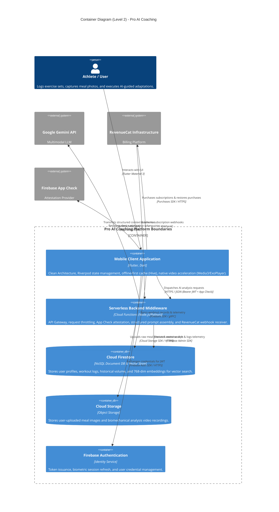
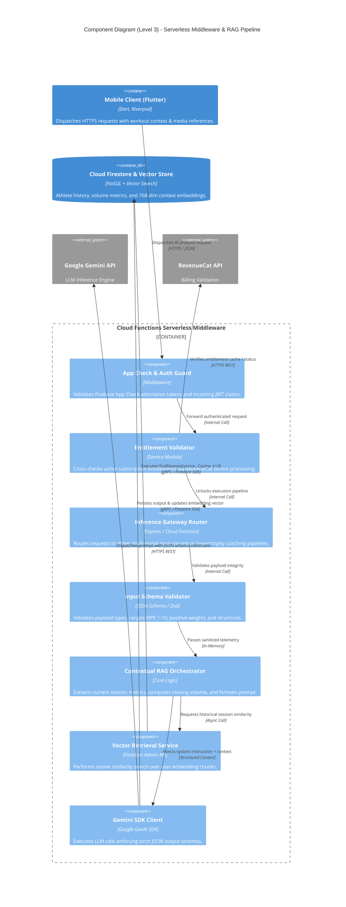
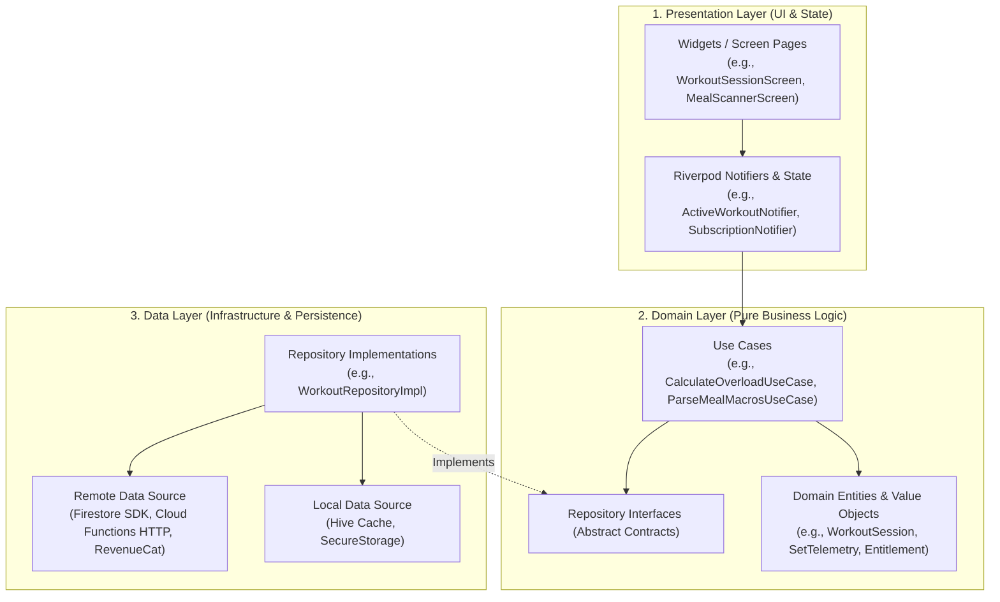
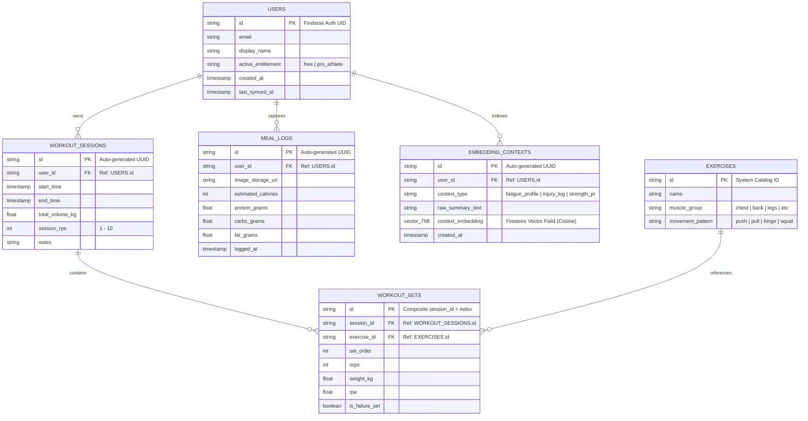
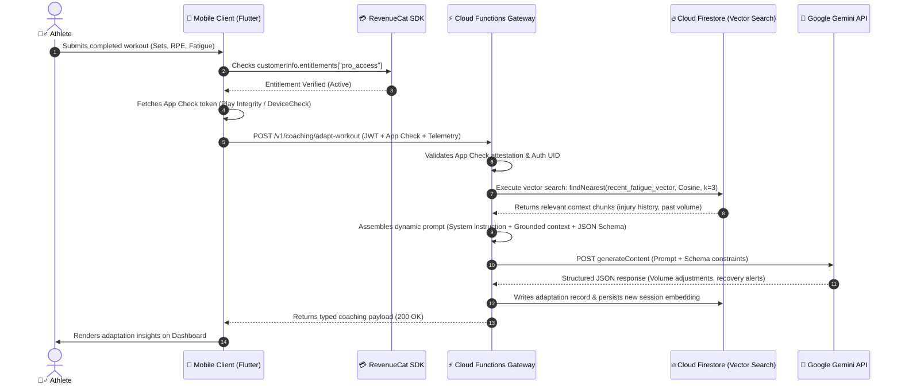

# 🏛️ Pro AI Coaching – Enterprise System Architecture & Engineering Documentation

---

## 📌 Executive Summary

**Pro AI Coaching** is an enterprise-grade mobile health and fitness platform engineered with Flutter. The system ingests and processes high-frequency workout telemetry (set/rep volume, Rate of Perceived Exertion [RPE], fatigue indexes) alongside multimodal meal imagery to deliver real-time biomechanical feedback and dynamic nutritional adaptations.

The architecture eliminates client-side API key exposure through a secure serverless gateway, executes high-dimensional semantic lookups via Cloud Firestore Vector Search, and isolates billing operations using RevenueCat. This document details the end-to-end design across all four levels of the C4 model, along with data persistence schemas, RAG orchestration flows, and security protocols.

---

## 🏛️ Level 1: System Context Diagram

The System Context diagram models the platform boundaries, core user personas, and external enterprise integrations.



---

## 📦 Level 2: Container Diagram

The Container diagram decomposes the platform boundary into independently deployable units, detailing runtime environments, responsibilities, and communication protocols.



### Container Specifications & Network Matrix

| Container / Component | Technology Stack | Network Protocol | Primary Responsibility |
| --- | --- | --- | --- |
| **Mobile Client** | Flutter 3.x, Dart | Native SDK / HTTPS / gRPC | UI rendering, reactive state management, local caching, native media capture. |
| **Backend Middleware** | Cloud Functions Gen 2 | HTTPS / REST (JSON) | API key isolation, rate-limiting, device verification, prompt construction. |
| **Document & Vector DB** | Cloud Firestore | gRPC / Firestore SDK | Telemetry persistence, offline synchronization, native vector indexing (`findNearest`). |
| **Media Storage** | Cloud Storage | HTTPS / Storage SDK | Scalable, access-controlled storage for raw imagery and form capture clips. |
| **Identity Management** | Firebase Auth | HTTPS / SDK | Secure credential handling, OAuth integrations, short-lived JWT generation. |
| **AI Inference Engine** | Google Gemini API | HTTPS / REST | Contextual reasoning, JSON schema enforcement, multimodal computer vision. |
| **Entitlement Service** | RevenueCat | HTTPS / REST | Cross-platform paywall management, Google Play/Apple receipt validation. |

---

## 🧩 Level 3: Component Diagram (Serverless Middleware & RAG Pipeline)

The Component diagram inspects the internal services of the Cloud Functions middleware, detailing how requests are validated, enriched with historical context, and processed by the AI engine.



### Component Design Highlights

1. **Gatekeeping via Cryptographic Attestation:** The `App Check & Auth Guard` rejects any request lacking a valid Firebase App Check token before executing backend logic, preventing script-driven denial-of-wallet attacks.
2. **Deterministic Schema Enforcement:** Outputs from the `Gemini SDK Client` use `responseSchema` parameters to ensure that responses strictly match strongly typed JSON representations, eliminating parsing errors in the mobile client.
3. **Targeted Vector Grounding:** Rather than querying an external vector database, the `Vector Retrieval Service` uses Cloud Firestore's native vector search index (`findNearest`), retrieving the top 3 contextual workout or injury notes via cosine similarity in a single database roundtrip.

---

## 🧱 Level 4: Code & Clean Architecture (Mobile Client)

The mobile client is engineered using Clean Architecture and Feature-First package separation, isolating UI components from domain business logic and external infrastructure drivers.



### Modular Directory Structure

```text
lib/
├── core/                                # Cross-cutting application infrastructure
│   ├── constants/                       # Route names, asset keys, and design tokens
│   ├── network/                         # Dio client, App Check & Auth interceptors
│   ├── services/                        # Native platform bridges, Media3 video player
│   └── errors/                          # Failure definitions and exception mappers
├── features/                            # Encapsulated feature-first domains
│   ├── workout_tracking/                # Exercise, set, rep, and RPE logging engine
│   │   ├── data/
│   │   │   ├── datasources/             # Local Hive cache & Remote Firestore service
│   │   │   ├── models/                  # Freezed DTOs and JSON serialization models
│   │   │   └── repositories/            # WorkoutRepositoryImpl
│   │   ├── domain/
│   │   │   ├── entities/                # WorkoutSession, SetMetric, FatigueIndex
│   │   │   ├── repositories/            # IWorkoutRepository (Domain contract)
│   │   │   └── usecases/                # SyncSessionUseCase, CalculateProgressiveOverload
│   │   └── presentation/
│   │       ├── controllers/             # ActiveWorkoutNotifier (AsyncNotifierProvider)
│   │       └── widgets/                 # SetInputRow, LiveVolumeChart, RestTimer
│   ├── ai_coaching/                     # Multimodal meal scanner & workout adaptation
│   │   ├── data/                        # Cloud Function endpoints & Gemini DTO mappers
│   │   ├── domain/                      # BiomechanicalFeedback & NutritionalPlan entities
│   │   └── presentation/                # CameraOverlay, AnalysisBottomSheet
│   └── subscription/                    # Monetization, paywalls, and billing state
│       ├── data/                        # RevenueCat Purchases SDK wrapper
│       ├── domain/                      # EntitlementStatus, SubscriptionPackage entities
│       └── presentation/                # PaywallScreen, SubscriptionStatusListener
└── main.dart                            # Dependency injection & Firebase initialization

```

---

## 🗄️ Data Model: Cloud Firestore Schema & Vector Search (ERD)

The database architecture balances real-time UI synchronization with high-throughput set telemetry, storing vector embeddings directly within user contexts.



---

## ⚡ Multimodal RAG & Inference Sequence

The following sequence illustrates how telemetry and media are transformed into personalized coaching feedback without leaking backend secrets or exposing ungrounded LLM prompts.



---

## 💳 Subscription & Navigation Lifecycle (RevenueCat)

To prevent navigation lockups and handle post-purchase routing deterministically, the application orchestrates billing events using a centralized reactive listener.

```mermaid
sequenceDiagram
    autonumber
    actor User as 👤 User
    participant Paywall as 🖼️ Paywall View
    participant SubNotifier as 🔄 SubscriptionNotifier (Riverpod)
    participant RCSdk as 📱 Purchases SDK (RevenueCat)
    participant AppRouter as 🧭 GoRouter / Navigation Stack

    User->>Paywall: Selects subscription package & taps purchase
    Paywall->>SubNotifier: executePurchase(Package)
    SubNotifier->>RCSdk: purchasePackage(package)
    
    Note over RCSdk: Native Google Play / App Store sheet handles payment
    RCSdk-->>SubNotifier: Returns CustomerInfo
    
    alt Entitlement Active
        SubNotifier->>SubNotifier: Updates state: SubscriptionState.premiumActive
        SubNotifier->>AppRouter: Navigates to Dashboard (pushReplacementNamed('/dashboard'))
        Paywall-->>User: Transitions smoothly to active dashboard
    else Purchase Cancelled / Pending
        SubNotifier->>SubNotifier: Updates state: SubscriptionState.idle
        Paywall-->>User: Displays non-blocking notification; remains on paywall
    else Entitlement Missing (Webhook Delay)
        SubNotifier->>RCSdk: syncPurchases() / getCustomerInfo()
        RCSdk-->>SubNotifier: Refreshed CustomerInfo
        SubNotifier->>AppRouter: Navigates to Dashboard
    end

```

### Essential Navigation Logic

```dart
Future<void> purchaseSubscription(Package package) async {
  state = const AsyncValue.loading();
  try {
    final customerInfo = await Purchases.purchasePackage(package);
    final isEntitled = customerInfo.entitlements.all['pro_access']?.isActive ?? false;

    if (isEntitled) {
      state = AsyncValue.data(SubscriptionStatus.premium);
      // Ensure context validity before driving the navigation stack
      ref.read(navigationServiceProvider).navigateToDashboard();
    } else {
      state = AsyncValue.data(SubscriptionStatus.free);
    }
  } on PlatformException catch (e) {
    final errorCode = PurchasesErrorHelper.getErrorCode(e);
    if (errorCode != PurchasesErrorCode.purchaseCancelledError) {
      state = AsyncValue.error(e, StackTrace.current);
    } else {
      state = AsyncValue.data(SubscriptionStatus.free);
    }
  }
}

```

---

## 🛡️ Enterprise Security, Reliability & CI/CD Standards

* **Zero-Trust Client Boundary:** All Gemini API interactions and system prompts reside strictly within Cloud Functions Gen 2. No LLM tokens or administrative credentials are compiled into the client binaries.
* **Cryptographic Attestation via App Check:** The backend rejects any request lacking an attestation token generated by Apple DeviceCheck or Google Play Integrity, neutralizing unauthorized scrapers and replay attacks.
* **Type-Safe Dynamic JSON Validation:** Serverless endpoints validate input payloads using explicit schema validators and enforce response structural integrity using Gemini `responseSchema` configurations, preventing client deserialization errors.
* **Offline-First Resilience:** Telemetry entries are written first to local cache via Hive and synchronized asynchronously to Cloud Firestore via persistent gRPC channels, guaranteeing zero data loss in intermittent connectivity scenarios.
* **Automated CI/CD Delivery:** Codemagic pipelines automate static Dart analysis, unit test suites, integration mocks, App Check environment credentialing, and store-compliant App Bundle / IPA code signing across staging and production build flavors.
